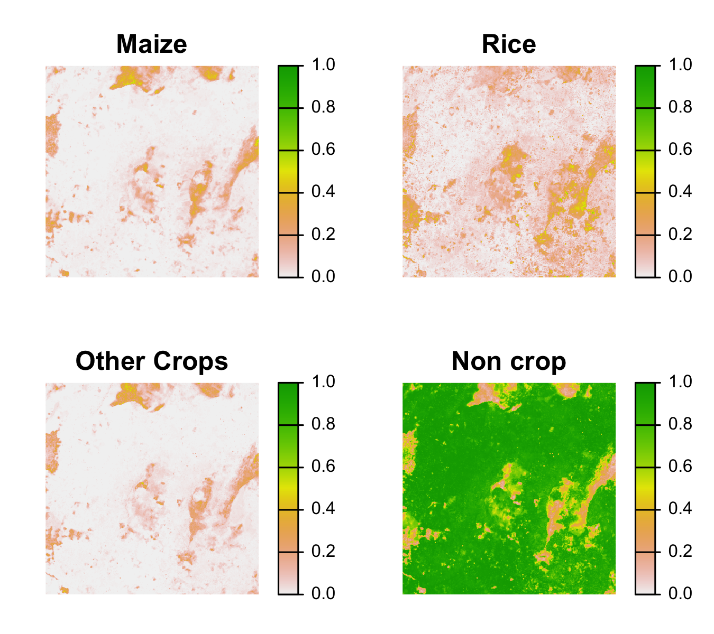

## Today
```{r}
#| eval: True
#| message: False
#| echo: false

library(dplyr)
library(ggplot2)
library(sf)
library(readr)
library(geospaar)
library(terra)

```

- `terra` wrap-up
- A few more advanced `R` applications
  - Parallelization
  - Random Forests example
  - `duckdb`/`geoparquet` 

---

## Data

```{r, eval=FALSE}
farmers <- system.file("extdata/farmer_spatial.csv", package = "geospaar") %>% 
  read_csv() %>% 
  st_as_sf(coords = c("x", "y"))
districts <- st_read(
  system.file("extdata/districts.geojson", package = "geospaar")
) %>% mutate(ID = 1:nrow(.))
roads <- read_sf(system.file("extdata/roads.geojson", package = "geospaar"))

chirps <- terra::rast(system.file("extdata/chirps.tif", package = "geospaar"))
chirpsz <- mask(chirps, districts)

raintot <- app(chirpsz, sum)
distsr <- rasterize(x = districts, y = raintot, field = "ID") 

```

---

## Terrain analysis with zonal statistics

```{r, eval=FALSE}
dem <- geodata::elevation_30s(country = "Zambia",  path = tempdir())
slope <- terrain(x = dem, v = 'slope', unit = 'degrees')
distsr_rs <- resample(x = distsr, y = slope, method = "near")
zoneslope <- zonal(x = slope, z = distsr_rs, fun = "mean", na.rm = TRUE)
zoneelevation <- zonal(x = dem, z = distsr_rs, fun = "mean", na.rm = TRUE)
```
---

## Subst
```{r, eval=FALSE}
# map zonal statistics
distr_slopes <- subst(x = distsr_rs, from = zoneslope$ID, 
                      to = zoneslope$slope)
distr_elevzone <- subst(x = distsr_rs, from = zoneelevation$ID, 
                        to = zoneelevation$ZMB_elv_msk)

# plot
s <- c(distr_elevzone, distr_slopes)
titles <- c("Elevation", "Slope")
par(mfrow = c(1, 2))
for(i in 1:nlyr(s)) {
  plot_noaxes(s[[i]], main = titles[i])
}
```

---

## Climate data summaries and zonal stats

```{r, eval=FALSE}
dt <- as.Date(gsub("Y", "", names(chirpsz)), format = "%y%j")
dt <- lubridate::parse_date_time(gsub("Y", "", names(chirpsz)), orders = "yj")
wk <- lubridate::week(dt)
weekly_rainfall <- lapply(unique(wk), function(x) {
  app(chirpsz[[which(wk == x)]], sum)
}) %>% do.call(c, .)
names(weekly_rainfall) <- paste0("wk", unique(wk))

rflim <- range(global(weekly_rainfall, range, na.rm = TRUE))
plot(weekly_rainfall, zlim = rflim)
```

---

## Distance

- plot distance from points
- points must be in same projection as model raster
```{r, eval=FALSE}
set.seed(1)
randsamp <- spatSample(rast(raintotalb), size = 10, xy = TRUE) %>%
  as_tibble %>%
  st_as_sf(coords = c("x", "y")) %>% 
  drop_na()
st_crs(randsamp) <- crs(raintotalb)
# #2
ptdistr <- terra::distance(rast(raintotalb), vect(randsamp))
ptdistrmsk <- mask(ptdistr, rast(raintotalb))
plot(ptdistrmsk)
```


---

## Modelling demo
### Random Forests
```{r, eval=FALSE}
# Train model
library(caTools)
library(randomForest)
library(geospaar)

# read in train set
train_ref <- system.file("extdata/train_reference.csv", 
                         package = "geospaar") %>% 
  read_csv()  %>% mutate(crop = factor(case_when(
  class == "Maize" ~ 1,
  class == "Rice" ~ 2,
  class == "Other" ~ 3,
  class == "noncrop" ~ 4
))) %>% dplyr::select(id, class, crop, !!names(.))
```

---

### Model 

```{r, eval=FALSE}
# prepare dataset
dset <- train_ref %>% filter(type == "mean") %>%
  select(-id, -class, -type, -seed)
set.seed(10)
samp <- sample.split(dset$crop, SplitRatio = 0.8)
train <- subset(dset, samp == TRUE)
test <- subset(dset, samp == FALSE)
# train %>% tidyr::drop_na()

# fit model
set.seed(123)
mod <- randomForest(crop ~ ., data = train, ntree = 1000,
                    importance = TRUE)
sum(diag(mod$confusion[1:4, 1:4])) / sum(mod$confusion[1:4, 1:4])
summary(mod) 

# Evaluation
pred <- predict(mod, newdata = test %>% dplyr::select(-c(crop)))
cm <- table(test$crop, pred)
# sum(diag(cm)) / sum(cm)

rf_results <- list("train" = train, "test" = test, "mod" = mod, 
                   "pred" = pred, "error_mat" = cm)
```

---

```{r, eval=FALSE}
imptab <- mod$importance
nms <- rownames(imptab)
imp_tbl <- as_tibble(imptab) %>% 
  mutate(Variable = nms) %>% 
  dplyr::select(Variable, MeanDecreaseAccuracy) %>% 
  arrange(MeanDecreaseAccuracy) %>% 
  mutate(order = 1:n()) %>% 
  mutate(Variable = gsub("\\.", "_", Variable))

p <- ggplot(imp_tbl) + 
  geom_point(aes(MeanDecreaseAccuracy, factor(order))) + 
  scale_y_discrete(labels = toupper(imp_tbl$Variable)) + 
  ylab("Variable") + xlab("Mean Decrease in Accuracy") + 
  theme_linedraw() + 
  theme(axis.text = element_text(size = 7), 
        axis.title = element_text(size = 7))
p
```

---

```{r, eval=FALSE, echo=FALSE}
pred_stack <- here::here("external/data/rststack_1016-1063.tif")
r <- terra::rast(pred_stack)
r <- terra::crop(r, terra::ext(r) * 0.2)
writeRaster(r, here::here("external/data/rststack_1016-1063_crop.tif"))
```


## Map

Look at Rmd file to see code use to make prediction map for crop types. 
```{r, eval=FALSE, echo=FALSE}
r <- terra::rast("external/data/rststack_1016-1063_crop.tif")

# pred_stack
predvars <- rownames(mod$importance)
# pred_stack <- "external/data/rststack_1016-1063.tif"
rtemp <- r[[1]]
v <- values(r)
v_tb <- as_tibble(v) %>% 
  mutate(
    ndvi_1 = (B8_1 - B4_1) / (B8_1 + B4_1),
    ndvi_2 = (B8_2 - B4_2) / (B8_2 + B4_2),
    rg1_ndvi_1 = (B8_1 - B5_1) / (B8_1 + B5_1),
    rg1_ndvi_2 = (B8_2 - B5_2) / (B8_2 + B5_2),
    rg2_ndvi_1 = (B8_1 - B6_1) / (B8_1 + B6_1),
    rg2_ndvi_2 = (B8_2 - B6_2) / (B8_2 + B6_2),
    
    gcvi_1 = (B8_1 / (B3_1 + 0.00001)) - 1,
    gcvi_2 = (B8_2 / (B3_2 + 0.00001)) - 1,
    rg1_gcvi_1 = (B8_1 / (B5_1 + 0.00001)) - 1,
    rg1_gcvi_2 = (B8_2 / (B5_2 + 0.00001)) - 1,
    rg2_gcvi_1 = (B8_1 / (B6_1 + 0.00001)) - 1,
    rg2_gcvi_2 = (B8_2 / (B6_2 + 0.00001)) - 1,
    
    mtci_1 = (B8_1 - B5_1) / (B5_1 - B4_1 + 0.00001),
    mtci_2 = (B8_2 - B5_2) / (B5_2 - B4_2 + 0.00001),
    mtci2_1 = (B6_1 - B5_1) / (B5_1 - B4_1 + 0.00001),
    mtci2_2 = (B6_2 - B5_2) / (B5_2 - B4_2 + 0.00001),
    
    reip_1 = 700 + 40 * ((B4_1 + B7_1) / 2 - B5_1) / (B7_1 - B5_1),
    reip_2 = 700 + 40 * ((B4_2 + B7_2) / 2 - B5_2) / (B7_2 - B5_2),
    
    nbr1_1 = (B8_1 - B11_1) / (B8_1 + B11_1),
    nbr1_2 = (B8_2 - B11_2) / (B8_2 + B11_2),
    nbr2_1 = (B8_1 - B12_1) / (B8_1 + B12_1),
    nbr2_2 = (B8_2 - B12_2) / (B8_2 + B12_2),
    
    ndti_1 = (B11_1 - B12_1) / (B11_1 + B12_1),
    ndti_2 = (B11_2 - B12_2) / (B11_2 + B12_2),
    
    crc_1 = (B11_1 - B3_1) / (B11_1 + B3_1),
    crc_2 = (B11_2 - B3_2) / (B11_2 + B3_2),
    
    sti_1 = B11_1 / (B12_1 + 0.00001),
    sti_2 = B11_2 / (B12_2 + 0.00001)
  ) %>% dplyr::select(all_of(predvars))

# clean up NA and Inf
v_tb <- v_tb %>% 
  mutate_all(function(x) ifelse(is.infinite(x), NA, x)) %>% 
  mutate_at(vars(predvars), zoo::na.aggregate)  # replace NA with mean

# predict probabilities of each class
pred <- predict(mod, v_tb, type = "prob")

# create probability stack
pred_stack <- do.call(c, lapply(1:ncol(pred), function(y) {
  predr <- rtemp
  values(predr) <- pred[, y]
  predr
}))
names(pred_stack) <- c("Maize", "Rice", "Other Crops", "Non crop")

png(filename = here::here("docs/figures/crop_probs.png"), width = 4.5, 
    height = 4, units = "in", res = 300)
terra::plot(pred_stack, axes = FALSE, range = c(0, 1), 
            plg = list(inset = -1))
dev.off()

```

```{r, echo=FALSE, out.width="60%", fig.align='center'}

```
---


## Parallelization

Note the use of `wrap` and `unwrap` to serialize the `spatRaster` object so it can be passed between cores. See [here](https://github.com/rspatial/terra/issues/36) for discussion.
```{r, eval=FALSE}
library(parallel)

# terra
r <- rast(ext(30, 31, -14, -13), res = 0.01, 
          crs = "+proj=longlat +datum=WGS84")
values(r) <- 1:ncell(r)

rp <- terra::wrap(r)
system.time(b <- mclapply(1:2000, function(x, r = rp) {
  r <- unwrap(r)
  values(r) <- sample(1:10, size = ncell(r), replace = TRUE)
  set.seed(x)
  r3 <- r2 <- r
  values(r2) <- values(r) * runif(n = ncell(r), 0.9, 1.2)
  values(r3) <- values(r) * runif(n = ncell(r), 0.8, 1.3)
  wrap(c(r3, r2, r))
}) %>% lapply(., unwrap))


```

---

## New formats

- [duckdb](https://cidree.github.io/duckspatial/)
- geoparquet

```{r, eval = FALSE}
# install.packages(c("duckdb"))
library(DBI)
library(duckdb)

con <- dbConnect(duckdb())

# Enable spatial operations
dbExecute(con, "INSTALL spatial;")
dbExecute(con, "LOAD spatial;")

# AWS connection
dbExecute(con, "INSTALL httpfs;")
dbExecute(con, "LOAD httpfs;")

# Anonymous access to a public S3 bucket
dbExecute(con, "
  CREATE SECRET (
    TYPE s3,
    PROVIDER config,
    REGION 'us-west-2'
  )
")
```

---


```{r, eval=FALSE}
s3_path <- "s3://mappingafrica/croplands/geoparquet/zambia_2024_v4.parquet"

system.time({
  result <- dbGetQuery(con, sprintf("
    SELECT COUNT(*) AS n_fields
    FROM read_parquet('%s')
  ", s3_path))
})

district_wkt <- districts %>%
  slice(48) %>%
  st_geometry() %>% 
  st_as_text()

dbGetQuery(con, sprintf("
  SELECT COUNT(*) AS n_fields
  FROM read_parquet('%s') AS f
  WHERE ST_Intersects(
    f.geometry,
    ST_GeomFromText('%s')
  )
", s3_path, district_wkt))

```


