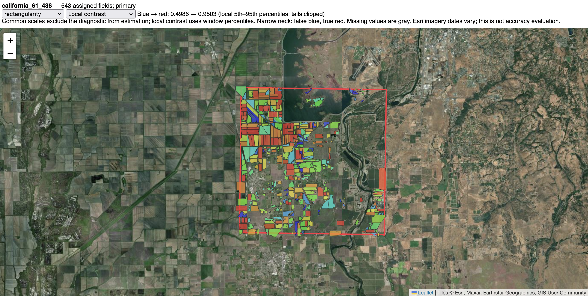
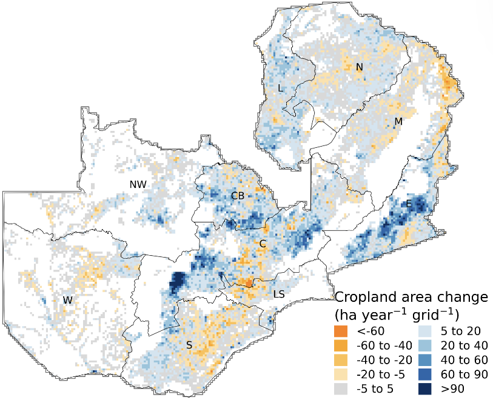

```{r setup, include=FALSE}
knitr::opts_chunk$set(echo = TRUE)
```

# Overview {#overview}

Each student will undertake an R-based final project for this class as part of a team. This project mayb be from a list of [potential projects below](projects.html#project-list), which are related to ongoing research projects, or could be one related to your own thesis work, which we will discuss and agree upon. There are two parts to the final project: 1) the project overview; 2) the final project itself.

# Project overview assignment

The purpose of this assignment is to provide a plan for your semester final project.

## Set-up

We say goodbye to the repos/packages used for assignments 1-5 (e.g. your version of `xyza1`). Working with your team, start a new package within a Git/GitHub repo, naming it something short but descriptive of the project you are doing. Follow the R package naming conventions to setup your repo name. This should be a private repo under either one of your profiles, or the agroimpacts organization.

As with your previous assignments, your work should be structured as an `R` package. That does not mean that you will necessarily need to be writing functions that are native to the package (i.e. documented functions living in the R folder that build with the package), but you should be writing your project up and showing your code and analysis within vignettes.

## Tasks

For this assignment, you should write a single vignette called "overview.Rmd", which has the following sections:

1.  Summary: A brief (up to 250 words) description of the project, and a bullet point or enumerated list of its primary objectives.

2.  Approach and Method: An outline of the analytical methods and code you plan to use, including the names of key packages that you will draw on. This section should be composed of the following sub-sections:

3.  Data: A brief (\~250 words) description **and** visualization of the datasets you will be using. That means spatial plots of the main datasets and their key values, and, as a bonus, a plot of summary statistics, e.g. a histogram or boxplot of one of the more importants variables in the dataset.

4.  Code: A bullet point summary of the analysis and coding approach that you propose to follow. For teams, this section should include a description of which member will be responsible for each bullet point.

5.  Timelines: Provide a timeline for when each portion of the analysis will be completed. These timelines should be constructed relative to the time period of presentations (during the last two weeks of class) and final project submission (during exam week). For teams, names should be associated with each step on the timeline.

6.  Anticipated outcomes: Briefly describe, as bullet points, the outcomes you expect for each of your primary project objectives

## An additional note for teams

For this last assignment, it doesn't make sense that team members do separate work in different branches of the repo, with the exception of cases where data fetching and wrangling tasks needed to describe and visualize the data are partitioned between members. In this case, team members should have separate vignettes in their respective branches describing the data gathering and processing steps to date. Otherwise, the expectation is that this assignment is presented as a jointly written vignette that builds with the package in the main branch. Please put your initials next to sections that you were responsible for writing. If you want to get really advanced, you can each jointly work on a version of overview in your own branches, and then do a merge and reconcile of your differing version in the main branch.

------------------------------------------------------------------------

<center>[Back to home](index.html)</center>

------------------------------------------------------------------------

# Final project

The following are the requirements and assessment approach for the final project:

## Overall scope

The purpose of the final product is to provide an overview of the results of the project you have been working on during the final unit of the class, building on the work you will have already presented in class during one of the last four sessions. The nature of this product can vary according to the type of project you are pursuing, which I would broadly define into two groups:

1.  Those that are more focused on developing a package that provides a set of R functions that will be more broadly useful;

2.  Those that are more analytical in nature, i.e. using R to answer particular questions of interest.

In the former case, we will want to see a good presentation of worked examples presented in your package vignette(s). In the latter case, your package vignette(s) should give an informative overview of your key findings and (if applicable) way forward for the project. Some projects may fall somewhere in between these two extremes.

## Structure and content

Regardless of the type of project you are developing, you will submit it as an `R` package (within the repo you started for your overview assignment), as we have been doing all semester. That `R` package should be fully reproducible, i.e.

```{r, eval = FALSE}
devtools::install_github("agroimpacts/yourproject", build_vignettes = TRUE)
browseVignettes("yourproject")
```

Works perfectly and gives us results that contain everything we need to evaluate the project. Datasets that are too large to be committed to the package repo should be linked to, but the code used to process them should be clear, and any figures built from them should be committed to the repo and incorporated in your package vignettes.

**NOTE on analyses**: It is strongly recommend for big datasets and slow-running analyses that you develop and run the analyses within `eval = FALSE` chunks, which can be accomplished as follows:

-   Save smaller intermediate datasets as needed, which can be read back in to downstream `eval = TRUE` chunks

-   Write plots to png files that you then read back in to the vignettes using `knitr::include_graphics()`. See the Rmds for Unit2, Module 2\* as examples

-   Following this approach will let you iterate much faster on testing whether your vignettes knit properly.

Vignettes will contain the material we are most interested in, but we will also examine your DESCRIPTION, NAMESPACE, function documentation (if applicable), i.e. the key components of making an R package and delivering it in a reproducible manner.

Jointly authored vignettes in group projects should have team member initials indicating which section each member worked on, specify the particular section. Otherwise, separately authored vignettes should have team member titles at the top.

As stated before, if there are clear, separable tasks that lend themselves to separate development efforts, team members should work on those and make frequent commits within their own repo branches.

`R` code should follow the [style](http://adv-r.had.co.nz/Style.html) we have been using all along.

The main item in your package that we will assess is/are the package vignette/vignettes.

## Vignette(s)

You can choose to have one or several vignettes, depending on how much sense it makes to break down the information into separate documents. Regardless, your vignette or vignettes should contain the following information (the names of the headings can vary though according to what makes sense)

### Introduction (or Overview)

A more detailed and informative overview of the project's purpose and objectives than what your provided in assignment 6. Approximate maximum length of 400 (individual) to 800 (team, assuming a single package vignette) words.

### Methods (or Approach)

For a more analytical project, provide a complete description of the methods you used to undertake the analysis, complete with informative illustrations and summaries of the input datasets. Approximate maximum length of 400 (individual) to 800 words.

For a project that is more tools-oriented, use this section to describe the purpose and rationale of the functions/capabilities you are developing, what other packages/software/tools it is building on, and provide informative illustrations and summaries of the dataset(s) you are using to demonstrate your functions. Same approximate length.

### Results (Worked Examples)

For analytical projects, describe and illustrate your results, using standard scientific reporting conventions: 1) plan on having 2-4 figures; 2) a similar number of statistical summaries; 3) describe the results in your figures and tables in (up to) 400-800 words (range refers to individual versus team efforts).

For tools-oriented projects, provide and illustrate 2-4 worked examples of how to use the functions in your package, with descriptive accompanying text that will help users to understand what the functions do and how to apply them (up to 400-800 words; range refers to individual versus team efforts).

### Discussion

For analytical projects, briefly provide your interpretation of the results, any uncertainties/difficulties encountered, and any next steps to be taken. Up to 400-800 words (range refers to individual versus team efforts).

For tools-oriented projects, describe any limitations of the package, improvements that can be made, and any plans to undertake these. Up to 400-800 words (range refers to individual versus team efforts).

Alternatively, you can choose to undertake one of the projects listed below.

This list is currently in thumbnail form, and will fill out during the next few weeks.

# Potential project list {#project-list}

## Visualize and analyze cropland characteristics and change

Clark's [Agricultural Impacts Research Group](https://agroimpacts.info/), through the [Mapping Africa](http://mappingafrica.io) project and as a collaborator on [Fields of the World](https://fieldsofthe.world/), has mapped crop field boundaries in several African countries (developed on Planet imagery) and contributed to global Sentinel-2 based maps.

There are several possible projects related to these data.

### The `ftwr` package

Develop an R package that provides the tools for querying, downloading, visualizing, and analyzing the geometric properties of FTW's [global field boundary maps](https://source.coop/ftw/global-data-2e) stored on Source Cooperative. Let's image tools that enable you to define a specific region of interest and year, extract the fields from the corresponding geoparquet files, calculate key properties, such as field area, count, and descriptive shape metrics (see [here](https://github.com/agroimpacts/ftw-baselines/blob/feat/instance-metrics/docs/polygon-export-and-descriptors.md) for python-based work on calculating those features), and then visualize those in a shiny interface, along with their corresponding underlying Sentinel-2 quarterly mosaics. Here is a simple example of the type of output you might make. 

```{r, echo=FALSE, fig.align="center", out.width="100%", fig.caption="A 10x10 km subset of 2024 field boundaries predicted over California, showing the rectangularity values of fields."}


```

### The `mappingafricar` package

Similar to above, but querying [Mapping Africa](mappingafrica.io)'s available maps (see [webmap](https://agroimpacts.github.io/mapping-africa/), and [repo](https://github.com/agroimpacts/mapping-africa) listing data sources).

### Map cropland change

Following methods developed by [Xiong et al (2026)](https://www.cabidigitallibrary.org/doi/abs/10.31220/agriRxiv.2026.00464) for Zambia, use our field boundary maps to develop gridded maps of cropland change trajectories in Nigeria, Angola, and Tanzania. 

```{r, echo=FALSE, fig.align="center", out.width="100%", fig.caption="Changes in cropland area in Zambia between 2018-2024 (Xiong et al, 2026)."}


```

## A drone-based sampling tool

For a prior [ECAAS](https://cropanalytics.net/) project, we created [a method](https://cropanalytics.net/wp-content/uploads/2021/08/D2.5-Service-Scale-up-Plan-V2-Aug-6-2021-1.pdf#D2.5%20Service%20Scale-up%20Plan.indd%3A.3986%3A32) for using Open Street Maps data together with agricultural layers and grid-based clustering to lay out probability samples over Ghana. The resulting sample sites   were visited by drone operator teams, who flew over those locations at 100 m altitude and collected drone imagery. These images were then used to identify crop types. The sampling method used `R` packages to do the job, but never went beyond scripts. Turn this approach into an `R` package that can be applied nearly anywhere to create such samples. Demonstrate that it produces samples that are representative of the landscapes being sampled.

## Map crop types

Those drone samples, together with on the ground data, provided a large number of vectorized data on crop types. Those data were used to train crop type models based on Sentinel-1 and Sentinel-2 predictors. Since then, Google's DeepMind has produced the [Alpha Earth Foundation embeddings](https://deepmind.google/blog/alphaearth-foundations-helps-map-our-planet-in-unprecedented-detail/), which provide a much richer (and cleaner) source of information for crop type mapping. Working with these labels and AEF embeddings drawn from [Source Cooperative](https://source.coop/tge-labs/aef), develop new crop type maps and see how well they compare to our earlier generation of models. Using our field boundary maps of Ghana as targets, make updated crop types maps of Ghana. 


## BYO project

Do you have your own project idea (we know some of you do!)? We are open to any potential project ideas that are geospatial in nature. For example:

### HERO-related projects

Did you work on the [HERO](https://www.clarku.edu/departments/hero-program/research/) project this past summer? Do have an interesting geospatial analysis you could develop as part of that project? If so, please see us to discuss the possibility. We have had several such projects in the past: [here](https://www.gcamerica.org/scholarships/scholar/aidan-caron) is a story about one of them.  


